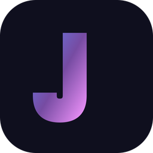
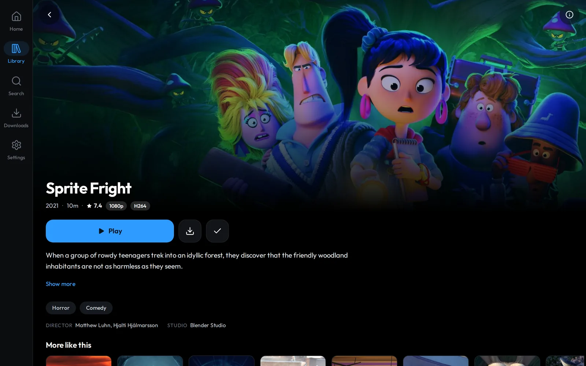
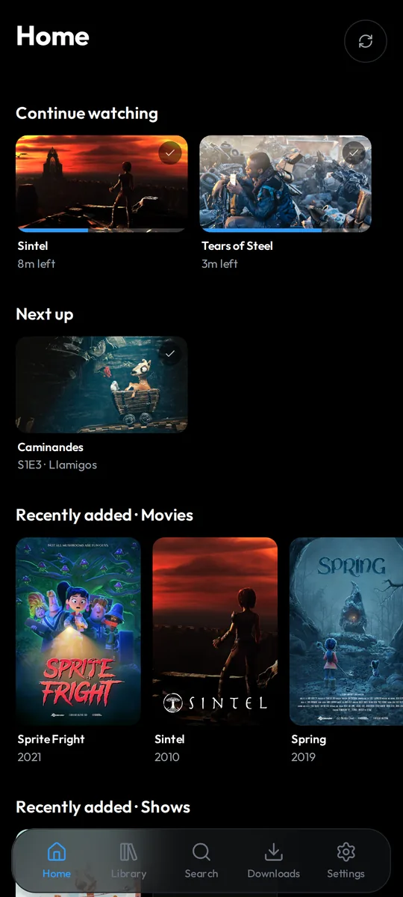
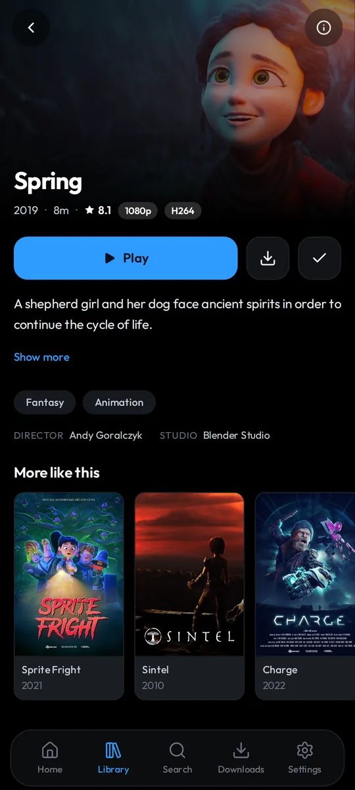
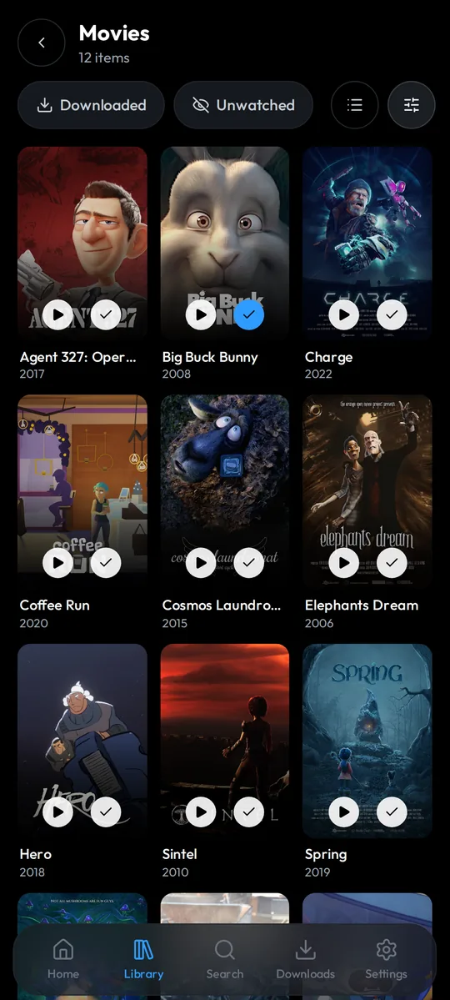
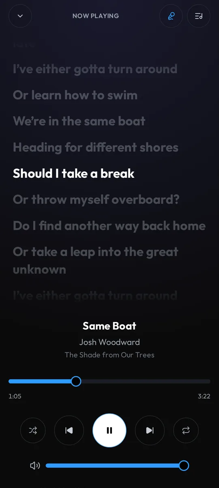
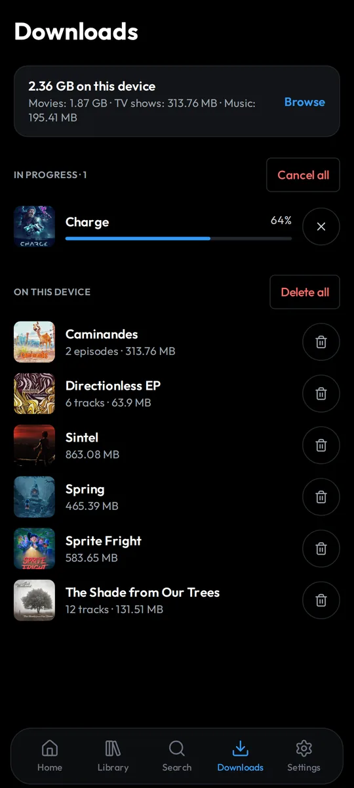

  

<h1 align="center">Vela</h1>

  A calm, offline-ready media player for your own <b>Jellyfin</b> or <b>Plex</b> server. 
  Films, series and music on Android.

  
  
  

  

<table>
  <tr>
    <td></td>
    <td></td>
    <td></td>
  </tr>
  <tr>
    <td></td>
    <td></td>
    <td></td>
  </tr>
</table>

## Why Vela

- **Plays files as they are.** Vela checks what your device can decode and plays
  the original file whenever it can. The server only converts a video when the
  device really can't play it, or when you ask for a lower quality.
- **Works offline.** Download films, episodes and albums at the quality you choose,
  with their artwork, then watch or listen with no network.
- **Music is a first-class citizen.** Original quality (FLAC included), synced
  lyrics, background playback, playlists and Android Auto.
- **A quiet interface.** No clutter, phone and tablet layouts, light and dark themes.

## Features

- 🎬 Films and series, with resume, "up next", skip intro and seek-bar previews
- 🎵 Music in original quality, lyrics, playlists, background playback
- ⬇️ Downloads to watch or listen offline
- 📡 Cast to a TV or speaker, 🚗 Android Auto
- 👥 Several servers and accounts side by side, Plex Home profiles
- 🌍 English and French, following your device language

## Install

Download `Vela-<version>-android.apk` from the
[latest release](https://github.com/v4lgrind/vela/releases/latest), open it on your
phone or tablet and allow the install. Android 7.0 or newer is required.

Vela checks for new versions by itself and offers to install them
(*Settings → App*). Updates keep your accounts and downloads.

**Also available:** Windows (`Vela-<version>-windows-x64.exe`), Linux
(`Vela-<version>-linux-x86_64.AppImage`, make it executable then run it) and
Android TV (same APK). These builds work, but the app is designed for phones and
tablets first.

## Connect to your server

**Jellyfin**: choose *Jellyfin*, enter the server address (for example
`http://192.168.1.10:8096`), then your username and password. *Quick Connect*
also works if it is enabled on your server.

**Plex**: choose *Plex*, tap *Get a code*, open [plex.tv/link](https://plex.tv/link)
on any device and enter the code. Pick your profile (and its PIN if it has one),
then your server. At home Vela uses your local network; elsewhere it switches to
the internet address by itself.

To add another server or account: *Settings → Switch server*. Plex users can
change profile from *Settings → Switch Plex profile*.

## Good to know

- **Offline:** downloaded items appear in *Downloads* and play without network,
  with their artwork. *Settings → Force offline mode* simulates having no network.
- **Quality:** music plays in original quality unless you set a limit in
  *Settings*; video is converted by the server only when your device cannot play
  the file or when you pick a lower quality in the player.
- **Seek-bar previews on Plex** require the server option *Generate video preview
  thumbnails*.

## Bugs and ideas

Open an [issue](https://github.com/v4lgrind/vela/issues). For a bug, please include:

- your Vela version (*Settings → App*) and your device;
- your server (Jellyfin or Plex) and its version;
- what you did, what you expected, and what happened;
- for playback problems, the logs from *Settings → Debug logs* (they can be exported).

## For developers

Build instructions, server compatibility notes and the architecture are in
[docs/development.md](docs/development.md).

## License and credits

Vela is released under the [MIT license](LICENSE).

Vela is an independent project. It is not affiliated with or endorsed by the
Jellyfin project or Plex, Inc. Jellyfin and Plex are trademarks of their
respective owners.

The screenshots show freely licensed works: Blender Studio open movies and
Creative Commons music. See [docs/screenshots/CREDITS.md](docs/screenshots/CREDITS.md).
